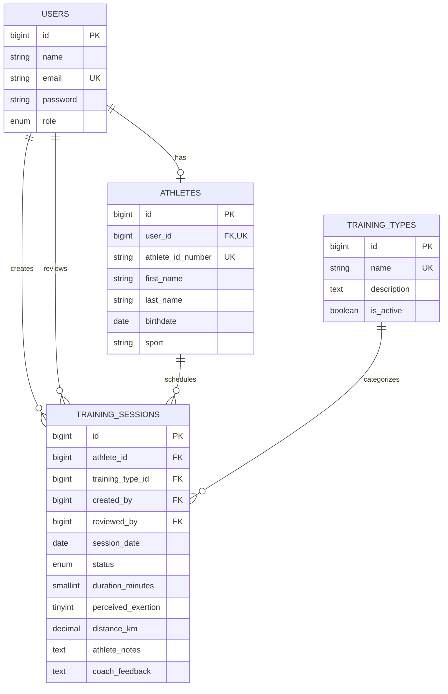

# Entity relationship diagram

The four domain entities and their relationships:

Export this Mermaid diagram as an image for the final report/slides.

Sanctum stores API bearer tokens in its framework `personal_access_tokens` table, which is an authentication infrastructure table in addition to the four domain tables.
